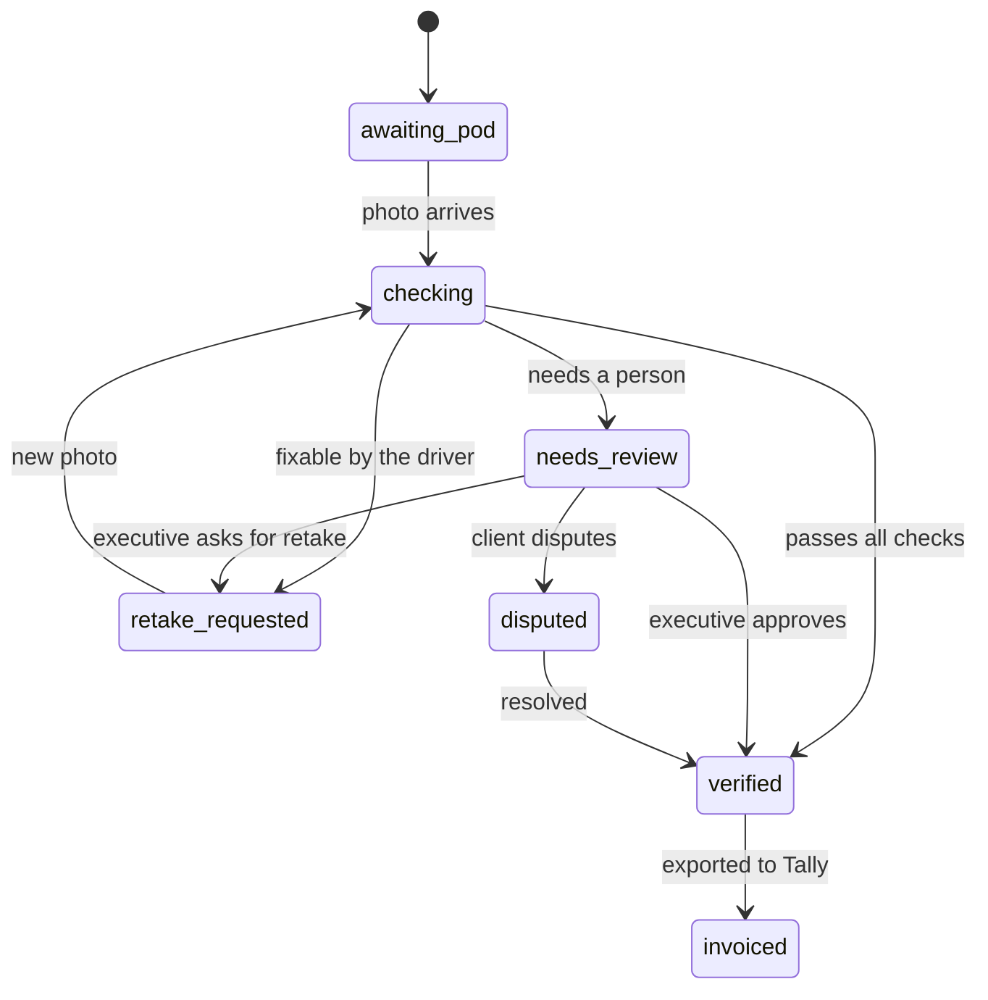

# Data model and trip statuses

Decided 6 Nov 2026. This is the source of truth for the schema, the status machine and the AI decision rule. If code and this file disagree, fix one of them on purpose and note it in the TDD.

## Decisions

A trip carries one POD status, set only by fixed rules and by people. The AI suggests field values and a verdict, but never moves money or sends an invoice.

- **Trip and photo are separate.** A trip has up to three photo attempts (the first plus two retakes). Each attempt keeps its own AI reading, so the review screen can show what changed between tries.
- **Every AI field is stored twice.** One copy is what the AI read; the other is the final value after any correction. The edit sits in the audit log with who made it and when.
- **Drivers have no accounts.** Each trip gets a signed link sent by SMS. It opens that one trip only. Own and hired drivers use the same path, which covers the SMS-link must-have.
- **The phone makes the attempt ID.** It's a UUID created at capture, so an offline photo retried five times is stored once.
- **Delivery time is when the photo is taken at the gate.** The 24-hour success metric then measures upload delay directly.
- **Money is stored in paise as integers, and times in UTC.** The screens show rupees and India time.
- **Consignee name and phone are masked in every API response.** One reveal endpoint returns them, and each reveal is logged (DPDP Act).
- **Photos sit in Postgres for the demo.** Each is under 300 KB. A storage key column keeps the move to S3 a one-line change later.

## Trip statuses

A trip's `pod_status` is one of seven values: `awaiting_pod`, `checking`, `retake_requested`, `needs_review`, `verified`, `disputed` and `invoiced`. Only `verified` trips appear in the billing queue.

The system makes the moves out of `checking`, using the rule below; people make every move out of `needs_review` and `disputed`. "Saved on the phone" is not a trip status: offline photos wait on the phone, and the trip stays `awaiting_pod` until one arrives.

## POD attempts and the AI decision rule

When an attempt's AI reading comes back, the server runs these checks in order, and the first match decides. Checks the driver can fix come first, because the driver is still at the gate.

1. The AI call fails or takes over 20 seconds: **needs review**, with reason `ai_unavailable`. The photo is kept.
2. The photo is blurred or too dark, or the stamp, signature or LR number can't be found: **retake requested** if fewer than two retakes have been used, otherwise **needs review** with `retake_cap_reached`.
3. The LR number read doesn't match the trip: **needs review**, `lr_mismatch`. It may be the wrong sheet, so a person decides.
4. The photo was taken more than 2 km from the consignee: **needs review**, `location_far`. A missing location doesn't count here, because dead zones are expected.
5. The remark mentions a shortage or damage: **needs review**, `shortage_remark` or `damage_remark`. This applies whatever the confidence.
6. The quantity received is below the quantity dispatched: **needs review**, `qty_short`.
7. Any field's confidence is below 0.80: **needs review**, `low_confidence`.
8. Otherwise: **verified**, by the AI.

The AI must return this shape, validated with Pydantic. A response that doesn't fit counts as rule 1.

| Field | Value | Confidence |
| --- | --- | --- |
| `lr_number` | text | 0 to 1 |
| `consignee_stamp` | present or absent | 0 to 1 |
| `quantity_received` | number and unit | 0 to 1 |
| `remarks` | text, plus a kind: none, shortage, damage or other | 0 to 1 |
| `delivery_date` | date | 0 to 1 |
| `signature` | present or absent | 0 to 1 |
| `image_quality` | ok, blurred or dark | none |

The model reports its own confidence, and that isn't calibrated. Tune the 0.80 threshold on the sample photos, and say so in the TDD.

## Data model

Twelve tables in Postgres. `trips` is the centre: a trip has many photo attempts, each attempt has its field readings, and every change lands in `audit_events`.

| Table | Key columns | Notes |
| --- | --- | --- |
| `trips` | `id`, `trip_code` (TRP-66120, unique), `client_id`, `branch_id`, `vehicle_id`, `driver_id`, `origin`, `destination`, `lr_number` (unique), `eway_bill_no` (12 digits, required), `qty_dispatched`, `qty_unit`, `freight_paise`, `consignee_name`, `consignee_phone`, `consignee_lat`, `consignee_lng`, `dispatched_at`, `expected_delivery_at`, `pod_status`, `status_reason`, `retakes_used` (0 to 2), `verified_at`, `verified_by`, `export_batch_id`, `invoiced_at`, `version` | `version` blocks two people saving over each other. Indexes on `pod_status`, `(client_id, pod_status)` and `eway_bill_no` |
| `pod_attempts` | `id` (UUID from the phone), `trip_id`, `attempt_no` (1 to 3), `image_bytes`, `image_key`, `size_bytes`, `sha256`, `captured_at` (phone), `received_at` (server), `gps_lat`, `gps_lng`, `gps_accuracy_m`, `distance_km`, `device_check`, `ai_status`, `ai_model`, `ai_latency_ms`, `ai_raw` (jsonb), `outcome`, `reason_codes` | Unique on `(trip_id, attempt_no)`. A repeated `id` is ignored, which makes offline retries safe. Over 300 KB is refused |
| `pod_fields` | `attempt_id`, `field`, `ai_value`, `ai_confidence`, `final_value`, `edited_by`, `edited_at` | One row per field per attempt. Billing reads `final_value` |
| `driver_links` | `id`, `trip_id`, `token_hash`, `expires_at`, `revoked_at`, `sent_at` | Only a hash of the token is stored. Valid for 72 hours, renewed on a retake |
| `users` | `id`, `name`, `email`, `password_hash`, `role`, `branch_id` | Office staff only |
| `clients` | `id`, `name`, `tally_ledger_name` | Billing cycle is the 1st to 15th and the 16th to month end |
| `branches`, `vehicles`, `drivers` | `vehicles.ownership` (own or hired), `drivers.phone`, `drivers.language` (hi, mr, en) | Driver phone is personal data, masked like the consignee's |
| `import_batches` | `id`, `filename`, `uploaded_by`, `rows_total`, `rows_ok`, `errors` (jsonb) | One per daily trip file |
| `export_batches` | `id`, `cycle_start`, `cycle_end`, `created_by`, `trip_count`, `total_paise`, `xml` | Trips point to their batch |
| `audit_events` | `id`, `trip_id`, `actor_type` (user, driver link, system), `actor_id`, `action`, `from_status`, `to_status`, `detail` (jsonb), `at` | Append-only: status changes, field edits, reveals, exports, retake requests |

Two figures come straight from these columns. POD within 24 hours is `received_at` minus `captured_at` on the first attempt. POD-to-invoice days is `invoiced_at` minus that first `received_at`.

## Roles and access

Three roles, each checked on the server for every request. The core build needs only the driver and the billing executive; the operations head is optional depth.

| Role | Signs in with | Can | Can't |
| --- | --- | --- | --- |
| Driver | The trip's SMS link | See that one trip, upload photos, see the result | See any other trip, edit fields, see consignee details |
| Billing executive | Email and password | Review, correct fields, approve, ask for a retake, mark disputed, export to Tally, reveal a consignee's contact | Change a trip after export, reveal contacts without a log entry |
| Operations head | Email and password | Dashboard, missing-POD list, resend a driver link, make a read-only client link | Approve or export |

The driver link's token is checked against `driver_links` on every upload and limited to 10 uploads an hour. Office sessions use a short-lived token in an http-only cookie. All inputs go through Pydantic, and an upload must be an image under 300 KB.

## Edge cases

Each case below is a test worth writing, since the brief scores tests on the most important logic.

| Case | What happens |
| --- | --- |
| The phone retries the same offline photo several times | The attempt ID is already stored, so the server returns the first result and stores nothing new |
| A photo arrives after the trip was approved or exported | Stored as an extra attempt and flagged; the status doesn't move |
| Two people save the same trip at once | The second save hits a stale `version` and gets a conflict; the screen reloads the trip |
| The driver opens the link after the trip is verified | Shows "done", with no camera button |
| The link has expired or been revoked | Says to call the office; the operations head resends it |
| The phone has no location | The photo is accepted and marked "no location"; rule 4 is skipped |
| The phone clock is wrong (photo dated after it arrived) | `captured_at` is replaced by `received_at` and the attempt is flagged |
| The photo is still over 300 KB after compression | The phone recompresses at lower quality; the server refuses anything bigger |
| The office asks for a retake after the driver has left | The driver gets an SMS with the link, and it counts toward the cap of two |
| A trip file row has no e-way bill, or repeats an LR number | That row is rejected with its reason; the other rows still import |
| The client disputes a POD | The executive marks it **disputed**; it counts toward the lost-or-disputed figure until resolved |

## Assumptions to label in the TDD

- "Retakes are capped at two" means at most three photos per trip.
- A trip is delivered when its photo is taken at the gate. A trip with no photo uses `expected_delivery_at` from the trip file.
- The trip file carries the branch, the quantity dispatched and the consignee's location. The brief's sample data shows none of these.
- The branches (Sambhajinagar, Pune, Nagpur) are sample names.
- Every client bills on the same two cycles a month.
- The confidence threshold is 0.80, the location radius is 2 km and the AI time limit is 20 seconds. All three are starting values to tune.
- The driver link lasts 72 hours.
- SMS, Tally and payments are mocked, as the brief allows.
