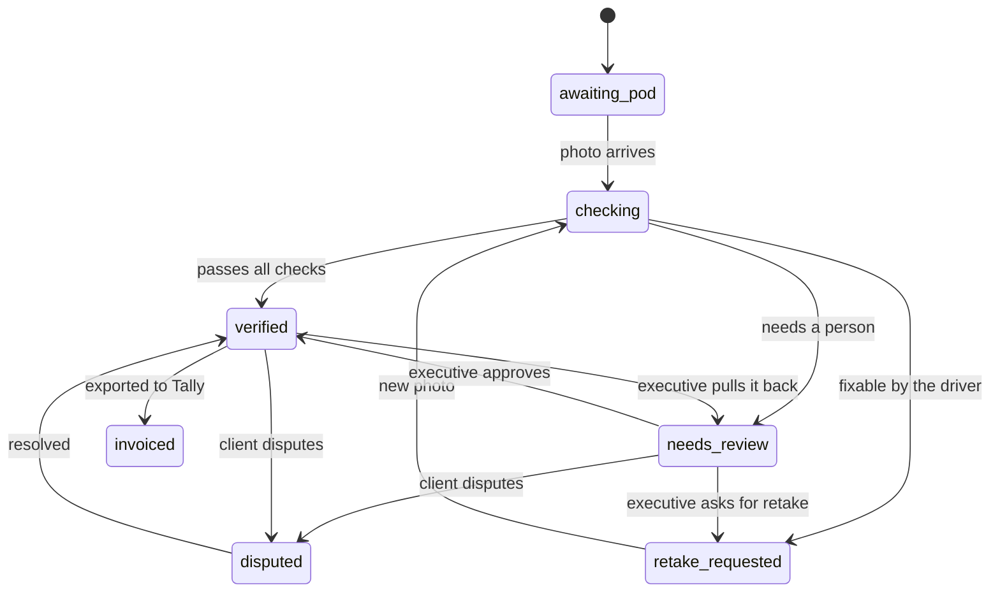

# Data model and trip statuses

Decided 6 Nov 2026. This is the source of truth for the schema, the status machine and the AI decision rule. If code and this file disagree, fix one of them on purpose and note it in the TDD.

## Decisions

A trip carries one POD status, set only by fixed rules and by people. The AI suggests field values and a verdict, but never moves money or sends an invoice.

- **Trip and photo are separate.** A trip has up to three photo attempts (the first plus two retakes). Each attempt keeps its own AI reading, so the review screen can show what changed between tries.
- **Every AI field is stored twice.** One copy is what the AI read; the other is the final value after any correction. The edit sits in the audit log with who made it and when.
- **Drivers have no accounts.** Each trip gets a signed link sent by SMS. It opens that one trip only. Own and hired drivers use the same path, which covers the SMS-link must-have.
- **The phone makes the attempt ID.** It's a UUID created at capture, so an offline photo retried five times is stored once.
- **Delivery time is when the photo is taken at the gate.** The 24-hour success metric then measures upload delay directly.
- **Money is stored in paise as integers, and times in UTC.** The screens show rupees and India time.
- **Consignee name and phone are masked in every API response.** One reveal endpoint returns them, and each reveal is logged (DPDP Act).
- **Photos sit in Postgres for the demo.** Each is under 300 KB. A storage key column keeps the move to S3 a one-line change later.
- **The AI check runs in the background.** The upload saves the photo and returns at once, and the phone polls for the result. A weak network can't lose a check that is already running.
- **Driver links outlast the journey.** A link expires 72 hours after `expected_delivery_at`, not 72 hours after sending, because an 800 km run can take about three days.
- **GPS and time are printed on the photo as well as stored.** A thin strip below the receipt carries the time, coordinates and trip code, so the proof stays with the image when it leaves the app, such as in the POD ZIP.
- **Billing groups trips.** One draft Sales voucher per client per export, with a line per trip. Billing by cycle only makes sense if trips are grouped.

## Trip statuses

A trip's `pod_status` is one of seven values: `awaiting_pod`, `checking`, `retake_requested`, `needs_review`, `verified`, `disputed` and `invoiced`. Only `verified` trips appear in the billing queue. `invoiced` means a draft voucher has been exported to Tally; Landed never issues an invoice itself.

The system makes the moves out of `checking`, using the rule below; people make every move out of `needs_review`, `disputed` and `verified`. Pulling a trip back from `verified` clears `verified_at` and `verified_by`, and is how an executive corrects a POD the AI wrongly passed. Disputes after invoicing are out of scope, because they would need a Tally reversal. "Saved on the phone" is not a trip status: offline photos wait on the phone, and the trip stays `awaiting_pod` until one arrives.

## POD attempts and the AI decision rule

When an attempt's AI reading comes back, the server runs these checks in order, and the first match sets the status and `status_reason`. `reason_codes` keeps every check that matched, so the reviewer sees them all. Checks the driver can fix come first, because the driver is still at the gate.

1. The AI call fails or takes over 20 seconds: **needs review**, with reason `ai_unavailable`. The photo is kept.
2. The photo is blurred or too dark, or the stamp, signature, LR number, quantity or date can't be found: **retake requested** if fewer than two retakes have been used, otherwise **needs review** with `retake_cap_reached`.
3. The LR number read doesn't match the trip: **needs review**, `lr_mismatch`. It may be the wrong sheet, so a person decides.
4. The photo was taken more than 2 km from the consignee: **needs review**, `location_far`. A missing location doesn't count here, because dead zones are expected.
5. The date on the paper is more than 1 day from the date the photo was taken, in India time: **needs review**, `date_mismatch`. It may be an old LR.
6. The remark has a kind other than none: **needs review**, `shortage_remark`, `damage_remark` or `other_remark`. This applies whatever the confidence, so a remark like "seal broken" never passes on its own.
7. The quantity received is below the quantity dispatched: **needs review**, `qty_short`. If it is above, or in a different unit: **needs review**, `qty_mismatch`.
8. Any field's confidence is below 0.80: **needs review**, `low_confidence`.
9. Otherwise: **verified**, by the AI.

The AI must return this shape, validated with Pydantic. A response that doesn't fit counts as rule 1.

| Field | Value | Confidence |
| --- | --- | --- |
| `lr_number` | text | 0 to 1 |
| `consignee_stamp` | present or absent | 0 to 1 |
| `quantity_received` | number and unit | 0 to 1 |
| `remarks` | text, plus a kind: none, shortage, damage or other | 0 to 1 |
| `delivery_date` | date | 0 to 1 |
| `signature` | present or absent | 0 to 1 |
| `image_quality` | ok, blurred or dark | none |

The model reports its own confidence, and that isn't calibrated. Tune the 0.80 threshold on the sample photos, and say so in the TDD.

## The AI check flow

1. The upload saves the attempt, moves the trip to `checking` and returns at once.
2. A background task calls Gemini with the 20-second limit, then runs the decision rule.
3. The phone polls every 2 seconds and shows the result.

An attempt stuck in `checking` for over 60 seconds counts as `ai_unavailable`, so a server restart can't strand a trip.

| Trip status after the check | What the driver sees |
| --- | --- |
| `verified` | The green done screen |
| `retake_requested` | The retake screen with the reason |
| `needs_review` | The green done screen, with "Sent to office". The driver can't fix it, so they aren't asked to wait |
| No result after 30 seconds | "You can go, we'll SMS if needed" |

## Offline capture

- **Phone check.** A blurred or dark photo fails a check on the phone, which needs no network. The driver is asked for a new photo on the spot, and this doesn't count toward the retake cap.
- **Way out of the phone check.** After two failures the driver can send the photo anyway, so a bad threshold can't trap them. `device_check` records the result.
- **One pending photo per trip.** A new shot replaces an unsent one.
- **Sending.** The phone retries on reconnect, on app open and every 30 seconds while the app is open. Background Sync is a stretch goal.
- **Printed strip.** It is drawn below the receipt at compression time, not over it, and the 300 KB limit includes it.

## Billing and Tally export

- **Voucher.** Each export makes one draft Sales voucher per client, with a line per trip carrying the LR and e-way bill numbers. One export can cover several clients, so one batch can hold several vouchers.
- **Cycle.** A trip's cycle comes from its delivery date in India time, not the day it was verified.
- **Shortage.** A shortage trip bills full freight, and the remark goes in the voucher narration. Deductions and GST are out of scope.
- **Re-download.** Downloading a batch again returns the same stored XML.

## Data model

Twelve tables in Postgres. `trips` is the centre: a trip has many photo attempts, each attempt has its field readings, and every change lands in `audit_events`.

| Table | Key columns | Notes |
| --- | --- | --- |
| `trips` | `id`, `trip_code` (TRP-66120, unique), `client_id`, `branch_id`, `vehicle_id`, `driver_id`, `origin`, `destination`, `lr_number` (unique), `eway_bill_no` (12 digits, required), `qty_dispatched`, `qty_unit`, `freight_paise`, `consignee_name`, `consignee_phone`, `consignee_lat`, `consignee_lng`, `dispatched_at`, `expected_delivery_at`, `pod_status`, `status_reason`, `retakes_used` (0 to 2), `verified_at`, `verified_by`, `export_batch_id`, `voucher_no`, `invoiced_at`, `is_demo`, `version` | `version` blocks two people saving over each other. `verified_by` is empty when the AI verified the trip. Trips on the same voucher share `voucher_no`. `is_demo` marks the five demo trips. Indexes on `pod_status`, `(client_id, pod_status)` and `eway_bill_no` |
| `pod_attempts` | `id` (UUID from the phone), `trip_id`, `attempt_no` (1 to 3 for checked attempts, 4 and up for late photos), `image_bytes`, `image_key`, `size_bytes`, `sha256`, `captured_at` (phone), `received_at` (server), `gps_lat`, `gps_lng`, `gps_accuracy_m`, `distance_km`, `device_check`, `ai_status`, `ai_model`, `ai_latency_ms`, `ai_raw` (jsonb), `outcome`, `reason_codes` | Unique on `(trip_id, attempt_no)`. A repeated `id` is ignored, which makes offline retries safe. Over 300 KB is refused |
| `pod_fields` | `attempt_id`, `field`, `ai_value`, `ai_confidence`, `final_value`, `edited_by`, `edited_at` | One row per field per attempt. Billing reads `final_value` |
| `driver_links` | `id`, `trip_id`, `token_hash`, `expires_at`, `revoked_at`, `sent_at` | Only a hash of the token is stored. Expires 72 hours after `expected_delivery_at`; a retake renews it to 72 hours from then |
| `users` | `id`, `name`, `email`, `password_hash`, `role`, `branch_id` | Office staff only |
| `clients` | `id`, `name`, `tally_ledger_name` | Billing cycle is the 1st to 15th and the 16th to month end |
| `branches`, `vehicles`, `drivers` | `branches.name`, `vehicles.registration_no`, `vehicles.ownership` (own or hired), `drivers.name`, `drivers.phone`, `drivers.language` (hi, mr, en) | Driver phone is personal data, masked like the consignee's |
| `import_batches` | `id`, `filename`, `uploaded_by`, `rows_total`, `rows_ok`, `errors` (jsonb) | One per daily trip file |
| `export_batches` | `id`, `cycle_start`, `cycle_end`, `created_by`, `trip_count`, `total_paise`, `xml` | Trips point to their batch. One batch can hold vouchers for several clients |
| `audit_events` | `id`, `trip_id`, `actor_type` (user, driver link, system), `actor_id`, `action`, `from_status`, `to_status`, `detail` (jsonb), `at` | Append-only: status changes, field edits, reveals, exports, retake requests |

Beyond the table, these are unique: `clients.name`, `branches.name`, `vehicles.registration_no`, `users.email` and `driver_links.token_hash`. Lookups get indexes on `driver_links.trip_id` and on `audit_events (trip_id, action, at)`, which the upload limit counts from. `pod_fields` values are `jsonb`, because quantity is a number and unit, and remarks are text and a kind.

Three figures come straight from these columns. POD within 24 hours is `received_at` minus `captured_at` on the first attempt. POD-to-invoice days is `invoiced_at` minus that first `received_at`. Lost or disputed counts `disputed` trips plus lost ones, where a POD is lost once it is still missing 20 days after `expected_delivery_at`.

## Roles and access

Three roles, each checked on the server for every request. The core build needs only the driver and the billing executive, so the executive has everything the core needs, including the dashboard. The operations head is optional depth and stays a separate demo login.

| Role | Signs in with | Can | Can't |
| --- | --- | --- | --- |
| Driver | The trip's SMS link | See that one trip, upload photos, see the result | See any other trip, edit fields, see consignee details |
| Billing executive | Email and password | Review, correct fields, approve, pull a trip back from verified, ask for a retake, mark disputed, export to Tally, reveal a consignee's contact, open the dashboard, import trips, resend a driver link | Change a trip after export, reveal contacts without a log entry |
| Operations head | Email and password | Dashboard, missing-POD list, resend a driver link, make a read-only client link | Approve or export |

The driver link's token is checked against `driver_links` on every upload. Uploads are limited to 10 an hour per trip, counted from `audit_events`, so a fresh link or a demo reset can't clear the count. A repeated attempt ID doesn't count. The limit also caps Gemini calls, and it applies the same in `DEMO_MODE`. Office sessions use a short-lived token in an http-only cookie. All inputs go through Pydantic, and an upload must be an image under 300 KB.

## Edge cases

Each case below is a test worth writing, since the brief scores tests on the most important logic.

| Case | What happens |
| --- | --- |
| The phone retries the same offline photo several times | The attempt ID is already stored, so the server returns the first result and stores nothing new |
| A photo arrives when the trip isn't `awaiting_pod` or `retake_requested`, such as after approval or export | It is a late photo: numbered 4 and up, stored, flagged in Review and not sent to Gemini. The status doesn't move |
| Two people save the same trip at once | The second save hits a stale `version` and gets a conflict; the screen reloads the trip |
| The driver opens the link after the trip is verified | Shows "done", with no camera button |
| The link has expired or been revoked | Says to call the office; a billing executive or the operations head resends it |
| The driver opens the link for the first time with no network | Nothing can load, because a PWA can't cache itself before its first visit. The SMS goes out at dispatch to make this less likely |
| The phone has no location | The photo is accepted and marked "no location"; rule 4 is skipped |
| The phone clock is wrong (photo dated after it arrived) | `captured_at` is replaced by `received_at` and the attempt is flagged |
| The photo is still over 300 KB after compression | The phone recompresses at lower quality; the server refuses anything bigger |
| The office asks for a retake after the driver has left | The driver gets an SMS with the link, and it counts toward the cap of two |
| The office asks for a retake when two are already used | The server refuses it and the button is disabled; the executive approves, corrects or marks it disputed |
| The phone check fails twice | The driver can send the photo anyway; the result is recorded |
| The driver takes a second photo in a dead zone | It replaces the unsent one |
| The server restarts during an AI check | After 60 seconds the attempt counts as `ai_unavailable` and goes to a person |
| The AI wrongly verifies a POD | An executive pulls the trip back to `needs_review` before export |
| The AI call fails | The six fields are blank, and the executive fills them in from the photo |
| A trip file row has no e-way bill, or repeats an LR number | That row is rejected with its reason; the other rows still import |
| The client disputes a POD before it is invoiced | The executive marks it **disputed** from Review; it counts toward the lost-or-disputed figure until resolved, and Review has a Disputed filter |

## Demo mode

These rules apply only when the `DEMO_MODE` env flag is on.

- **Five demo trips.** One for each scenario: clean, blurry, no stamp, short by 6 cartons and wrong LR. Each trip's LR number matches its sample photo.
- **Trying one.** "Open the driver demo" shows the five scenarios. Picking one resets that trip and creates a fresh link. The reviewer can use the sample photo or take a real one, and either goes through the real Gemini check.
- **What a reset touches.** Only rows with `is_demo` true: that trip plus its attempts, fields and links. It never touches seeded history, and it leaves `export_batches` as they are. A test proves this.
- **What a reset keeps.** `audit_events` stays append-only, so the reset adds a `demo_reset` event and the upload count carries on.
- **Gemini limit.** The 10-an-hour limit still applies per trip, so demo use tops out at 50 Gemini calls an hour.
- **Figures.** Demo trips stay out of the dashboard figures, so a reset can't move them. They do appear in Review and Billing, so a reviewer can follow one end to end.
- **Mock SMS.** Every send writes an `sms_sent` audit event without the token. In `DEMO_MODE` the API returns the link once, and the office screen shows "Mock SMS sent" with an "Open link" button. No new table, so there are still twelve.

## Assumptions to label in the TDD

- "Retakes are capped at two" means at most three photos per trip.
- A trip is delivered when its photo is taken at the gate. A trip with no photo uses `expected_delivery_at` from the trip file.
- The trip file carries the branch, the quantity dispatched and the consignee's location. The brief's sample data shows none of these.
- The branches (Sambhajinagar, Pune, Nagpur) are sample names.
- Every client bills on the same two cycles a month.
- The confidence threshold is 0.80, the location radius is 2 km, the date tolerance is 1 day and the AI time limit is 20 seconds. All four are starting values to tune.
- The driver link lasts until 72 hours after expected delivery.
- "Basic phones" means low-cost Android phones with a camera and browser. Keypad phones aren't supported, so those trips stay on the missing-POD list.
- A POD is lost once it is still missing 20 days after expected delivery, the top of the brief's 10 to 20 day range.
- A shortage trip bills full freight. Deductions and GST are out of scope.
- A trip's billing cycle comes from its delivery date.
- SMS, Tally and payments are mocked, as the brief allows.

## Limits to state in the TDD

- Masking can't cover the photo itself, which shows the consignee's stamp and possibly a signature.
- Photos go to Google for the AI check. Check the Gemini terms for this key's tier before writing this up.
- The first open of a driver link needs network.
- A closed app sends nothing until it is reopened, unless the Background Sync stretch goal lands.
- Disputes after invoicing aren't handled.
